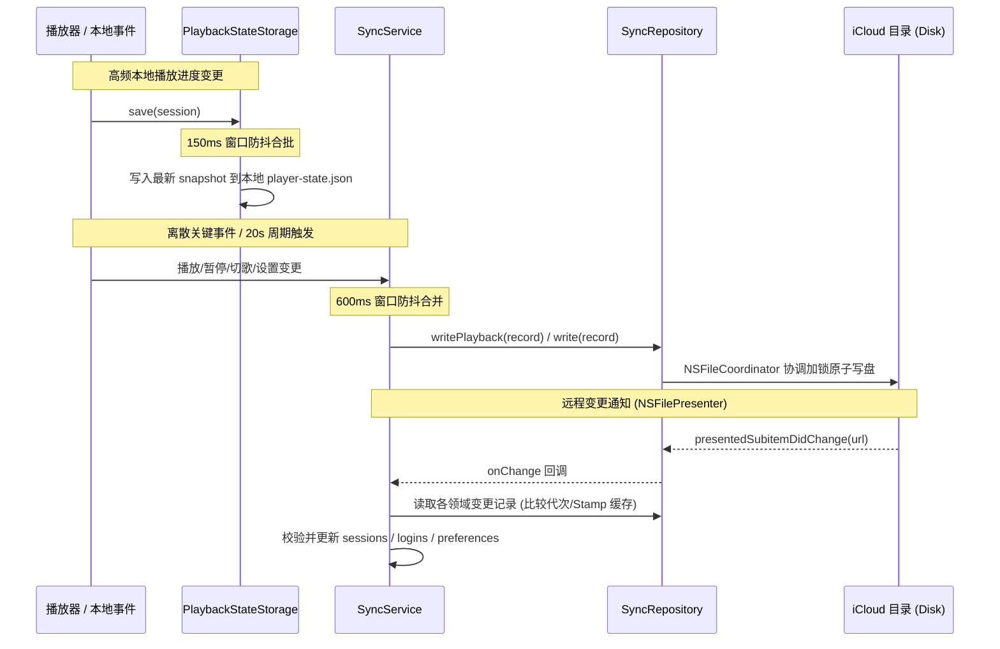

# iCloud 同步

Kumone 的多端同步支持在 Mac 与 iPhone 之间**接续播放进度**、**同步通用偏好设置**以及**流转网易云登录态**。

系统不依赖官方专有云服务器或中心化数据库，而是基于标准的共享文件夹（如 iCloud Drive 共享目录或原生 iCloud 容器），使用文件协调与逻辑修订实现无中心、弱一致的最终收敛。使得不同签名或重签名的侧载版本能无缝互通。

---

## 一、系统架构与核心组件

同步系统在架构上分为四层：

```
┌────────────────────────────────────────────────────────┐
│             UI / 特性层 (SyncSettingsSection)           │
│         设置开关、错误展示、文件夹选择器、接续入口              │
└───────────────────────────┬────────────────────────────┘
                            │
┌───────────────────────────▼────────────────────────────┐
│              协调服务层 (SyncService)                   │
│   事件订阅防抖、跨领域调度、逻辑时钟递增、UI 发布状态管理         │
└──────┬────────────────────┬────────────────────┬───────┘
       │                    │                    │
┌──────▼──────┐      ┌──────▼──────┐      ┌──────▼───────┐
│  播放存储    │      │  偏好同步    │      │   登录同步    │
│(Playback-   │      │(Preferences)│      │(SyncedLogin) │
│ SyncStore)  │      │             │      │              │
└──────┬──────┘      └──────┬──────┘      └──────┬───────┘
       │                    │                    │
┌──────▼────────────────────▼────────────────────▼───────┐
│             通用仓储层 (SyncRepository)                 │
│ 安全作用域管理、NSFileCoordinator 并发锁、代次缓存、冲突版本解决│
└────────────────────────────────────────────────────────┘
```

### 核心组件职责

- [`SyncService`](../Sources/Kumone/Core/Sync/SyncService.swift)：主线程单例与服务外观。汇聚播放器、偏好设置和账号状态的 Combine 变更事件，在 600ms 窗口内防抖调度；管理连接标识 `connectionID` 与逻辑修订时钟 `counter`。
- [`SyncRepository`](../Sources/Kumone/Core/Sync/SyncRepository.swift)：隔离执行的 Actor 仓储。管理文件安全作用域（Security Scope）、处理 `NSFileCoordinator` 读写互斥、维护基于文件资源身份及内容代次的解码缓存、探测并清理 `NSFileVersion` 冲突版本。
- [`PlaybackSyncStore`](../Sources/Kumone/Core/Sync/PlaybackSyncStore.swift)：播放领域的专有存储策略。负责大体积队列快照与轻量检查点指针的拆分、复用与重连恢复，并提供 7 天到期孤儿队列的定期清理（GC）。
- [`PlaybackStateStorage`](../Sources/Kumone/Core/Sync/PlaybackStateStorage.swift)：独立的本地快照存储引擎。通过 150ms 窗口对播放器的本地高频进度进行防抖合批，应用退出时同步 flush，保障本地持久化不因网络/云端异常而受阻。

---

## 二、存储模型与文件组织

同步目录以统一的 `Kumone/` 文件夹为根节点，由根目录下的 `repository.json` 标识有效性。每个设备拥有独立的设备专属目录，**各设备只向自己的目录写盘，绝不直接修改其他设备的文件**，从而从物理层消除跨设备文件写冲突。

### 目录结构树

```text
Kumone/
├── repository.json                                     # 仓库元信息 (应用标识与格式版本)
└── Devices/
    ├── <Device-UUID-A>/                                # 设备 A 的独立命名空间
    │   ├── playback.json                               # 播放检查点指针 (轻量级：当前进度、游标、队列引用)
    │   ├── preferences.json                            # 偏好设置 (带逐字段修订计数)
    │   ├── login.json                                  # 登录凭据 (账号 ID、昵称、认证 Cookie)
    │   └── Queues/                                     # 不可变历史队列目录
    │       ├── <Queue-Revision-UUID-1>.json            # 完整队列快照 (去重歌曲列表、原始/随机顺序等)
    │       └── <Queue-Revision-UUID-2>.json
    └── <Device-UUID-B>/                                # 设备 B 的独立命名空间
        └── ...
```

### 传输信封 `SyncRecord<Payload>`

所有同步文件均以统一的 [`SyncRecord`](../Sources/Kumone/Core/Sync/SyncRecord.swift) 信封格式包装：

```swift
struct SyncRecord<Payload: Codable>: Codable, Identifiable {
    let schemaVersion: Int       // 格式版本 (当前为 1，高版本拒绝应用)
    let revision: SyncRevision   // 逻辑修订 (全局单调 counter + deviceID)
    let deviceName: String       // 设备显示名称 (仅用于 UI 展示)
    let updatedAt: Date          // 物理更新时间 (仅用于展示与过期判断)
    let payload: Payload?        // 业务载荷；为 nil 时代表本设备的主动删除标记 (Tombstone)
}
```

### 设备身份与 Keychain 隔离

- 设备身份（`deviceID: UUID`）持久化于本机的系统 Keychain，**不参与** iCloud 同步与设备间迁移。
- 相同 Keychain 访问组下重新安装应用会复用原 ID，确保能过滤本机记录；同名设备（如两台均叫 "MacBook Pro"）凭借底层独立 UUID 互相隔离。
- 若 Keychain 读写发生故障，系统将直接终止连接并报错，杜绝因临时随机生成假 ID 而在云端产生重复垃圾节点。

---

## 三、目录授权与安全作用域生命周期

为了保证非官方签名的应用或越狱/侧载版本均可使用，同步支持通过系统文件选择器授予普通文件夹访问权（Security-Scoped URL）：

```mermaid
stateDiagram-v2
    [*] --> 未连接: 初始/关闭状态

    未连接 --> 连接中: 用户手选目录 / 启动恢复书签
    state 连接中 {
        开启安全作用域: startAccessingSecurityScopedResource()
        --> 目录有效性校验: checkDirectory() 校验文件夹存在
        --> 仓库初始化或校验: validateRepository()
        --> 生成或刷新安全书签: bookmarkData(withSecurityScope)
    }

    连接中 --> 活跃连接: 全部校验通过 (持有 scopedURL)
    连接中 --> 未连接: 校验失败 / 取消 (释放 scopedURL 并报错)

    活跃连接 --> 活跃连接: 正常读写 / 20s 周期刷新
    活跃连接 --> 熔断断开: 目录在运行中被物理删除 / 撤销权限
    活跃连接 --> 未连接: 用户主动关闭同步 (disconnect)

    熔断断开 --> 连接中: 用户点击「重新连接」重新选目录
```

### 授权设计的核心原则

1. **单点授权与持有**：手选目录（`connect`）与书签恢复（`restore`）各自作为入口，成功时仅开启一次 `startAccessingSecurityScopedResource()` 并由 `scopedURL` 持有，直至连接失败或显式断开；恢复流程不再嵌套开启授权，杜绝多层作用域提前释放的竞态 Bug。
2. **防误重建保护**：若用户在外置存储或 iCloud 中主动删除了同步文件夹，书签恢复时的 `checkDirectory()` 将直接拦截并抛出 `SyncError.unavailable`，绝不会盲目调用 `createDirectory` 重新在原路径凭空重建已删除文件夹。
3. **静默熔断与错误收敛**：运行中若外部目录丢失或权限失效，系统立即停止云端轮询与刷新任务、断开当前连接、清空远端接续与共享账号，并将错误静默收敛在 iCloud 设置页卡片内（提供「重新连接」入口）。

---

## 四、三大业务领域的同步策略

### 1. 播放接续 (Playback)

播放同步兼顾了**快照完整性**与**网络流量/写盘开销**，采用了指针与实体分离的存储设计。

#### 指针与快照分离

- **不可变队列快照**（`Queues/<queueRevision>.json`）：保存去重后的歌曲元数据表、原始列表、打乱顺序、下一首列表等。体积相对较大（几百 KB），但只要歌曲队列未增删重排，就保持不可变并在多轮播放中复用。
- **轻量检查点指针**（`playback.json`）：仅保存进度秒数（`progress`）、当前曲目在队列中的下标（`currentIndex`）、循环模式以及对应的 `queueRevision` 引用。体积极小（几百字节），高频覆写时不产生流量负担。

#### 写入与复用生命周期

1. **队列变更时**：先写出新的 `<queueRevision>.json`，再原子替换 `playback.json` 指针。
2. **仅进度/暂停变化时**：直接复用已有队列文件，仅原子覆写 `playback.json`。
3. **重连/冷启动时**：优先基于本地内存或磁盘缓存校验已有快照，内容相同时无缝复用，不重复落盘。

#### 7 天到期孤儿队列维护 (GC)

随着切歌和换歌，历史队列文件会变成无人引用的孤儿文件。
- **清理周期**：使用单调时钟 `ContinuousClock`，在每次连接的首次写操作以及此后每隔 24 小时检查一次。
- **保留原则**：当前检查点指针引用的队列、未解决冲突版本引用的队列、本连接已知的上一份快照、以及修改时间在 **7 天宽限期**以内的文件均严格保留。
- **容错隔离**：清理属于次要维护任务，若遇到文件系统只读、无法枚举目录或某些文件无法获取修改时间，系统仅记录诊断日志跳过该项。

#### 账号与接续边界

- 只有当前设备登录的网易云账号与播放会话所属账号**完全一致**时，才会发布播放状态；访客或账号不匹配时自动发布删除标记撤回旧数据。
- 远端设备播放只展示接续提示行（设备名 + 歌曲名），需用户主动点击确认后才拉取应用。

---

### 2. 偏好设置 (Preferences)

- **逐字段 LWW 合并**：偏好字段（音质、外观、逐字歌词开关、音源启用列表等）独立携带该字段被修改时的逻辑修订版本号 `counter`。多设备发生冲突时，以逻辑修订号最高者胜出，**不依赖物理时钟**。
- **保护本机独占配置**：音量大小、音频输出设备、本地缓存清理、窗口位置尺寸以及仅 Mac 专属的 AutoMix 详细配置保留在本机，不参与跨设备漫游。
- **首次连接先拉后推**：新安装设备首次开启同步时，先完整读取并应用云端已有配置，仅对云端缺失的字段补齐发布，避免新设备初始化默认值覆写老设备的个性化配置。

---

### 3. 登录凭据 (Login)

- **默认关闭**：跨端账号流转涉及凭据安全，需用户在设置中显式手动打开「登录同步」。
- **凭据信任边界**：登录 Cookie 在当前同步目录下以明文 JSON 保存（防范依赖 iCloud 自身文件系统权限）。**同步目录本身即为信任边界，切勿将同步文件夹配置在公共/共享外置盘中**。
- **接收端端内校验**：接收方设备收到远端登录数据后，通过独立的临时 `NeteaseClient` 实例发起线上静默验证，验证通过且本机当前无登录时才安全落盘应用。
- **独立退出机制**：任意设备主动登出账号时，仅撤回自身发布的设备记录（发布 Tombstone），不向网易云服务端注销该跨端共享 Session，其他已登录设备不受干扰。

---

## 五、合并时序与一致性保障



1. **最终一致性**：同步系统没有强一致的分布式事务锁。在遇到弱网、离线播放时，产生的本地修订将在重新联网后随下一轮同步传播并依照逻辑版本号有序合并。
2. **全量兜底轮询**：除了响应 `NSFilePresenter` 的实时文件变动通知外，系统每隔 20 秒以及在应用前后台切换时会自动触发全量领域轻量刷新，弥补系统级文件监控可能出现的偶发通知遗漏。

---

## 六、故障排查与验证备忘

| 故障现象 | 常见原因 | 系统处理行为                                | 恢复方案 |
| :--- | :--- |:--------------------------------------| :--- |
| **设置页显示「同步目录不可用」并出现「重新连接」** | 用户在访达中删除了同步目录，或外置驱动器拔出 | 触发熔断断开连接，注销观察者，撤除接续行，保留旧书签            | 插回驱动器或在设置中点击「重新连接」重新选定目录 |
| **设置页显示「等待 iCloud 下载」** | 远端发来了新的检查点指针，但大体积队列文件仍在 iCloud 云端下载中 | 保留上一份完整播放会话展示，不把残缺队列拼给新指针             | 等待系统下载完成，下一轮自动恢复接续 |
| **切换账号后远端设备无法接续** | 两台设备登录的网易云账号 UID 不一致 | 不展示接续提示行，或接续执行时校验拦截                   | 确保两端通过登录同步或手动登录同一网易云账号 |
| **历史队列文件占用空间过大** | 设备长期处于离线状态，未触发定时清理 | 恢复连接后，在首次写入或 24 小时周期内自动扫描并清理 7 天前孤儿文件 | 保持正常播放与网络连接，系统将自动回收 |

> [!TIP]
> **本地开发与测试清理**
> 若在开发过程中改动了存储协议或测试了损坏的文件，可在关闭同步开关后，直接清空同步目录下的 `Kumone/` 文件夹。各设备的本机播放状态和当前账号独立保存在本地沙盒中，不会因云端清理而丢失。
