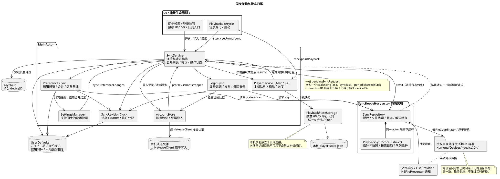
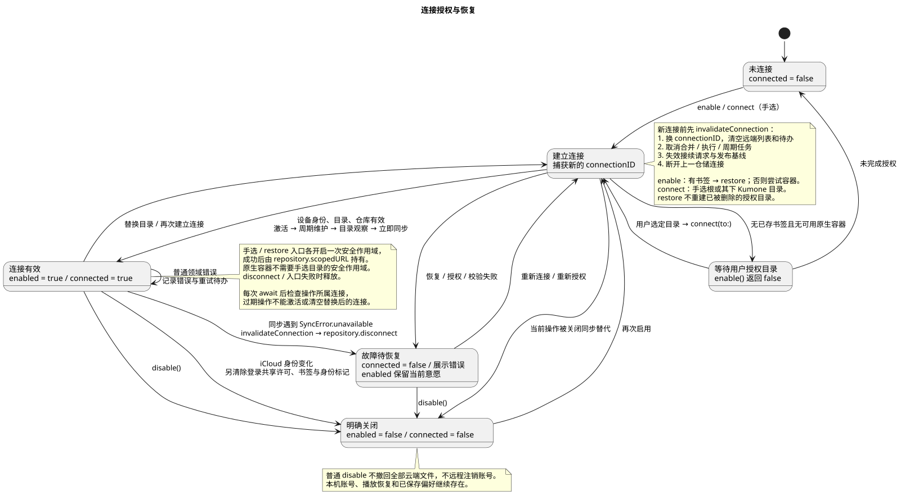
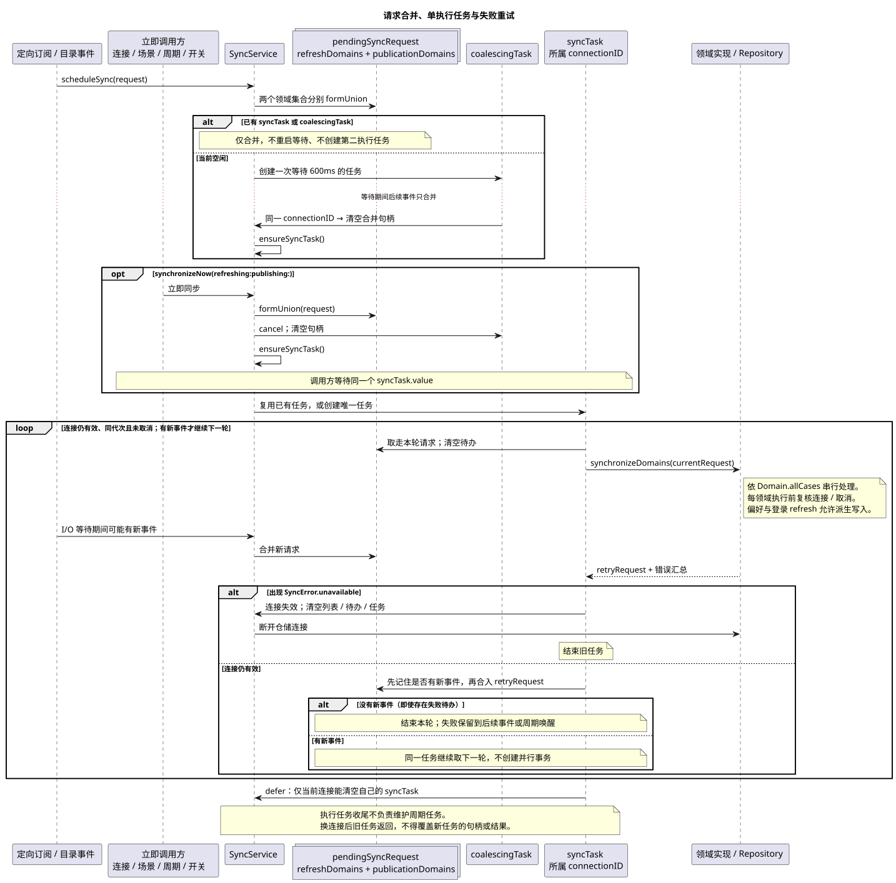
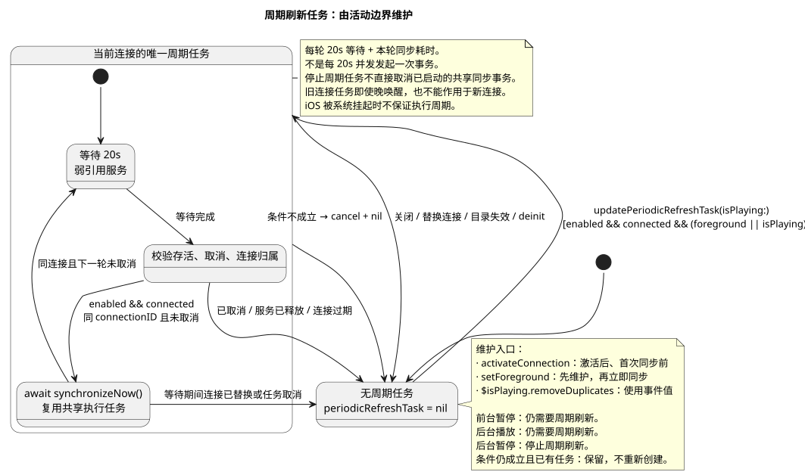
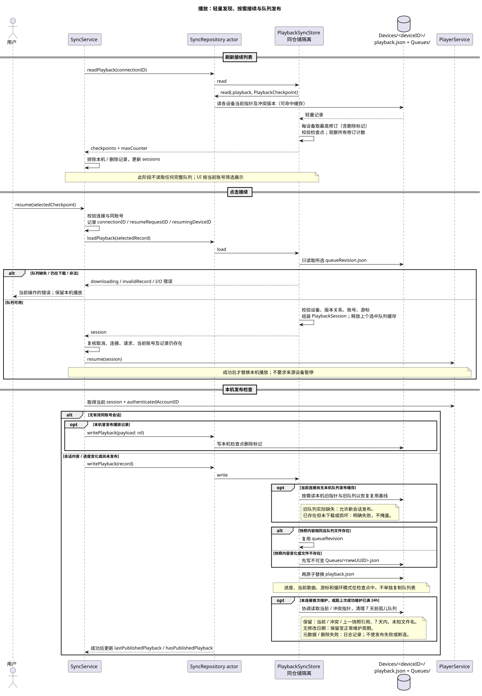
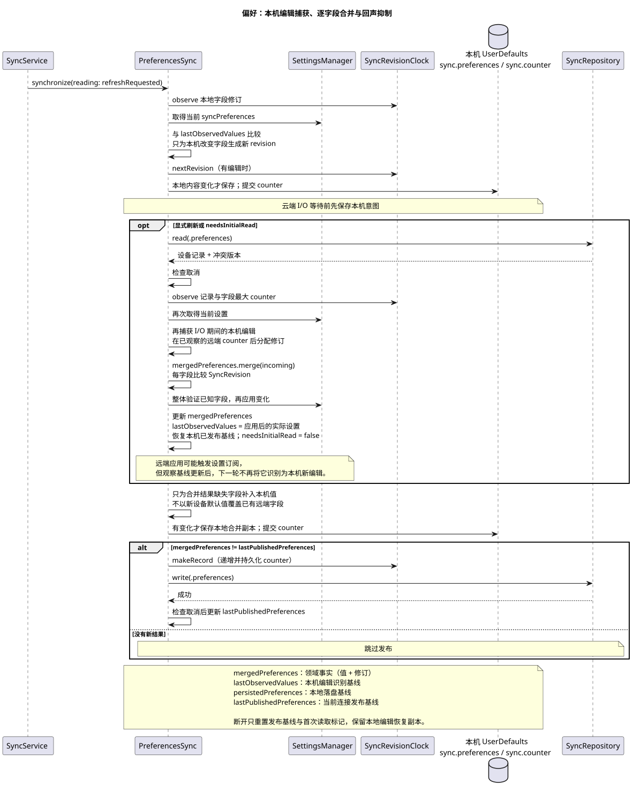
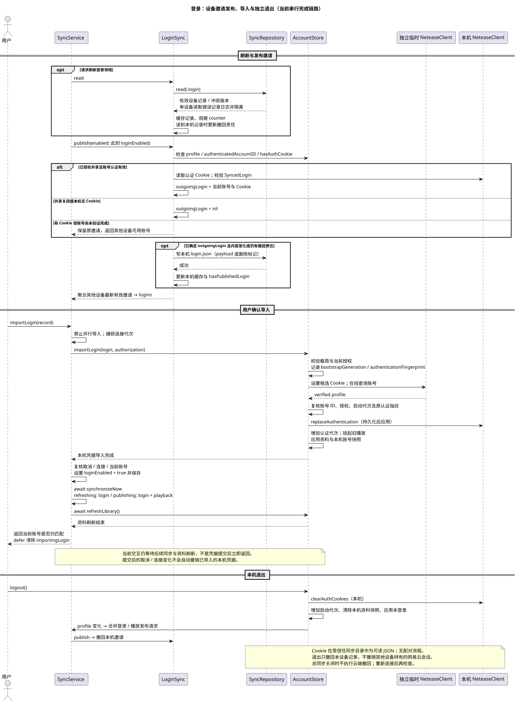
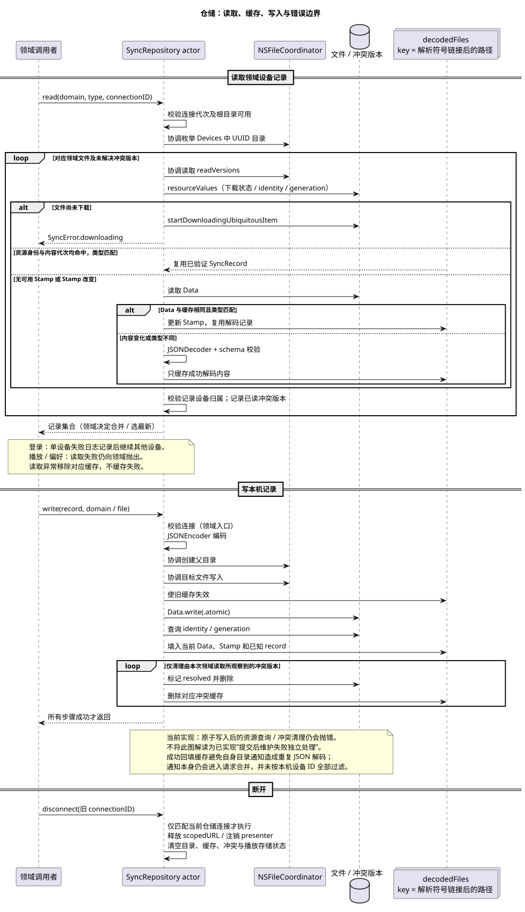

# iCloud 同步实现

## 系统结构与组件职责



*([architecture.puml](architecture.puml))*

| 执行上下文        | 组件                                                                                                                                                       | 职责                                                                                                                                                        |
|:-------------|:---------------------------------------------------------------------------------------------------------------------------------------------------------|:----------------------------------------------------------------------------------------------------------------------------------------------------------|
| **UI 与生命周期** | `SyncSettingsSection`<br>`PlaybackHandoff` <br>`SyncedLoginButtons`<br>`PlaybackLifecycle`                                                               | 设置开关、目录授权、接续入口、账号导入；监听应用启动、前后台切换与退出事件。                                                                                                                    |
| **协调层**      | [`SyncService`](../../Sources/Kumone/Core/Sync/SyncService.swift)                                                                                        | 服务外观与主协调器。持有 `connectionID` 代次；合并领域待办；管理唯一执行循环 `syncTask` 与周期刷新 `periodicRefreshTask`；维护 UI 状态（`sessions`、`logins`、`errorMessage`）。                       |
| **逻辑时钟**     | [`SyncRevisionClock`](../../Sources/Kumone/Core/Sync/SyncRevisionClock.swift)                                                                            | 维护单调递增计数器 `counter`；分配 `SyncRevision(counter, deviceID)`；提供偏好设置逐字段 LWW 仲裁依据。                                                                              |
| **业务领域**     | [`PreferencesSync`](../../Sources/Kumone/Core/Sync/PreferencesSync.swift)<br>[`LoginSync`](../../Sources/Kumone/Core/Sync/LoginSync.swift)               | **偏好**：逐字段 LWW 合并、捕获本机编辑并利用 `lastObservedValues` 抑制回声。<br>**登录**：本机凭据发布与 Tombstone 撤回、其他设备登录邀请聚合。                                                            |
| **仓储与协调**    | [`SyncRepository`](../../Sources/Kumone/Core/Sync/SyncRepository.swift)<br>[`PlaybackSyncStore`](../../Sources/Kumone/Core/Sync/PlaybackSyncStore.swift) | **仓储 Actor**：管理 `scopedURL` 生命周期；`NSFileCoordinator` 读写加锁；基于文件 Stamp 缓存已解码对象；清理 `NSFileVersion` 冲突版本。<br>**播放存储策略 (struct)**：在仓储隔离域内运行，管理队列复用与 7 天孤儿队列清理。 |
| **本地引擎**     | [`PlaybackStateStorage`](../../Sources/Kumone/Core/Sync/PlaybackStateStorage.swift)                                                                      | 独立串行队列；以 150ms 窗口防抖合批写入本地 `player-state.json`；应用退出时同步 flush。                                                                                              |
| **目录监听**     | `SyncDirectoryPresenter`                                                                                                                                 | `NSFilePresenter` 监听云端根目录变更，将路径事件转为对应领域的刷新请求。                                                                                                             |

---

## 标识与数据信封

### 核心标识对照

| 标识                | 存储位置        | 生命周期                      | 作用                          |
|:------------------|:------------|:--------------------------|:----------------------------|
| `deviceID`        | 本机 Keychain | 永久持有（同 Keychain 访问组重装可复用） | 标识本机物理写入目录；不漫游至云端。          |
| `connectionID`    | 内存          | 每次连接建立、失效或重连时生成新 UUID      | 区分连接代次；用于丢弃旧连接返回的异步 I/O 结果。 |
| `resumeRequestID` | 内存          | 每次点击接续时生成                 | 区分接续请求；使前一次未完成的异步接续加载失效。    |
| `SyncRevision`    | 信封字段        | 随记录保存在云端文件中               | 逻辑版本号；用于判定数据新旧与删除覆盖。        |
| `queueRevision`   | 队列文件名       | 队列内容未改动则永久复用              | 队列快照唯一标识，被检查点指针引用。          |
| `updatedAt`       | 信封字段        | 每次写入时记录物理时间               | 仅用于 UI 相对时间展示与过期判断，不参与版本仲裁。 |

### 传输信封

所有同步文件均以统一信封封装:

```swift
struct SyncRecord<Payload: Codable>: Codable, Identifiable {
    let schemaVersion: Int // 格式版本
    let revision: SyncRevision // 逻辑修订 (全局单调 counter + deviceID)
    let deviceName: String // 设备名 (用于 UI 展示)
    let updatedAt: Date // 物理更新时间 (用于展示与过期判断)
    let payload: Payload? // 业务载荷；nil 代表该设备的主动删除标记 (Tombstone)
}
```

- **Tombstone 机制**：`payload == nil` 表示本设备主动删除对应记录。高修订版本的 Tombstone 会覆盖低修订版本的有效数据。

---

## 目录结构与持久化边界

### 共享目录结构

```text
Kumone/
├── repository.json                                     # 仓库元信息
├── login-key.json                                      # 登录密钥描述 (密钥 ID、盐、迭代次数、校验值；不含密钥)
└── Devices/
    ├── <Device-UUID-A>/                                # 设备 A 命名空间
    │   ├── playback.json                               # 轻量检查点 (当前歌曲、进度、游标、queueRevision)
    │   ├── preferences.json                            # 偏好配置 (包含各字段修订计数)
    │   ├── login.json                                  # 登录邀请 (账号 ID、昵称、密钥 ID、加密 Cookie；nil 为撤回)
    │   └── Queues/                                     # 不可变队列快照目录
    │       ├── <Queue-Revision-UUID-1>.json            # 完整队列快照 (去重歌曲列表、乱序表等)
    │       └── <Queue-Revision-UUID-2>.json
    └── <Device-UUID-B/
        └── ...
```

### 本地与共享存储分界

```text
本机 Keychain                 本机 UserDefaults
└── deviceID                     ├── 开关、安全书签、iCloud 身份标记
                                 ├── sync.counter (时钟计数)
本机播放恢复                       └── sync.preferences (合并字段 + 观察值投影)
└── player-state.json

同步目录 (iCloud Drive / 授权目录)
└── Kumone/
    └── ...
```

- **Keychain 异常保护**：若 Keychain 读取失败，连接流程终止并报错，不使用随机临时 ID，避免在云端产生孤立的设备目录。
- **本地播放状态独立**：场景切换时保存本机播放检查点，由 `PlaybackStateStorage` 以 150ms 窗口合批写入；应用正常退出时同步 flush。本机保存不依赖云端是否可用。

---

## 连接与目录授权



*([connection.puml](connection.puml))*

### 状态流转机制

- **未连接（Disconnected）**：初始或关闭状态。
- **建立连接中（Connecting）**：触发 `enable()` 或 `connect(to:)` 时生成新 `connectionID`，失效旧连接。
  `enable()` 有书签时恢复书签，恢复失败则返回错误；无书签时尝试原生容器，容器不可用时由界面请求目录授权。
  `connect(to:)` 建立手选目录连接。连接前校验 `repository.json`，手选目录与书签恢复成功后保存安全书签。
- **连接有效（Connected）**：持有已验证的目录连接，注册目录通知，执行首次立即对齐；应用位于前台或仍在播放时维护 20s 周期刷新任务。
- **故障待恢复（Unavailable）**：同步或 I/O 过程中捕获 `SyncError.unavailable`，立即触发静默熔断；释放 `scopedURL`
  ，注销观察者，清空远端状态，保留配置并展示「重新连接」入口。
- **明确禁用（Disabled）**：用户主动关闭同步；释放所有任务与资源，不清除云端文件，不注销远端账号。

### 授权管理规则

- **单点持有**：手选目录（`connect`）与书签恢复（`restore`）各调用一次 `startAccessingSecurityScopedResource()`；
  返回 true 时由仓储的 `scopedURL` 持有授权，直至断开或失败时释放。原生容器连接不启用该安全作用域。
- **防误重建**：书签恢复时若发现目标文件夹不存在，直接返回 `SyncError.unavailable`，不调用 `createDirectory` 重建目录。
- **静默熔断**：同步过程中捕获 `SyncError.unavailable` 时，断开连接，注销观察者，清空远端接续与共享账号列表，将错误收敛在设置界面内，不弹全局弹窗。
- **关闭语义**：`disable()` 仅停止本机同步与定时任务，不删除云端已存在的文件，亦不远程注销账号。

---

## 请求合并与调度



*(源文件：[scheduling.puml](scheduling.puml))*



*([periodic-refresh.puml](periodic-refresh.puml))*

### 服务核心入口契约

| 方法                                       | 调度逻辑与契约                                                                              |
|:-----------------------------------------|:-------------------------------------------------------------------------------------|
| `start()`                                | 注册 Combine 订阅，根据已保存的设置和书签恢复连接。                                                       |
| `scheduleSync(request)`                  | 将领域待办合入 `pendingSyncRequest`；空闲时启动 600ms 合并窗口（`coalescingTask`）。**新事件仅合入待办，不延后倒计时**。 |
| `synchronizeNow(refreshing:publishing:)` | 合入待办，取消当前的 600ms 等待任务，直接触发或等待共享 `syncTask` 完成。                                       |
| `ensureSyncTask()`                       | 若已有执行任务则复用，否则为当前连接启动唯一的异步执行循环。                                                       |
| `synchronizeDomains(...)`                | 串行按领域执行同步，汇总执行失败的领域写入 `retryRequest`。                                                |
| `updatePeriodicRefreshTask(isPlaying:)`  | 仅在 `enabled && connected && (foreground \|\| isPlaying)` 时启动 20s 周期任务。               |

### 触发矩阵

| 触发事件                     | refresh     | publication | 调度方式              | 说明                        |
|:-------------------------|:------------|:------------|:------------------|:--------------------------|
| **连接建立**                 | 全部领域        | 全部领域        | 立即并等待             | 首次全量对齐。                   |
| **前后台切换**                | 全部领域        | 全部领域        | 立即并等待             | 进入前台立即对齐；切入后台前执行一次落盘检查。   |
| **周期唤醒**                 | 全部领域        | 全部领域        | 20s 定时等待          | 活跃状态下补偿系统可能遗漏的文件通知。       |
| **播放状态变更** (切歌/队列/乱序/FM) | 无           | 播放          | 600ms 合并          | 离散状态变更防抖合批。               |
| **播放 / 暂停**              | 无           | 播放          | 立即维护周期 + 600ms 发布 | 暂停且位于后台时停用周期任务。           |
| **偏好设置修改**               | 无           | 偏好          | 600ms 合并          | 本机修改字段分配新 counter 并提交。    |
| **账号资料 / 认证变更**          | 无           | 登录、播放       | 600ms 合并          | 登出时触发 Tombstone 撤回发布。     |
| **目录文件变更通知**             | 变更对应领域      | 无显式请求       | 600ms 合并          | 仅在活跃连接下响应，领域内可能派生写回。      |
| **登录同步开关切换**             | 登录          | 登录          | 立即并等待             | 开关切换立即触发发布或 Tombstone 撤回。 |
| **登录导入成功**               | 登录          | 登录、播放       | 串行等待完成            | 验密成功后同步远端并刷新资料库。          |
| **点击接续**                 | 目标记录引用的完整队列 | 无           | 独立按需加载            | 不拉取全量队列，仅加载目标快照并交付播放器。    |

---

## 各领域同步逻辑

### Playback



*([playback.puml](playback.puml))*

- **指针与快照分离**：
    - 不可变队列快照（`Queues/<UUID>.json`）：包含去重曲目元数据、原始列表与乱序表。内容未改动时在多轮会话中复用该文件。
    - 轻量检查点（`playback.json`）：包含账号、当前曲目、进度秒数、当前下标与 `queueRevision` 引用。日常进度更新只写入此文件。
- **按需接续**：列表刷新时仅读取远端设备的 `playback.json`，不读取完整队列。用户点击接续后，才拉取对应的
  `queueRevision.json`，核验账号和游标后交付播放器。
- **7 天孤儿队列清理 (GC)**：在每次连接激活后的首次写入以及之后每隔 24 小时检查一次。当前指针引用、冲突版本引用及 7
  天内修改的队列快照均保留，超出 7 天且无引用的孤儿文件自动删除。清理失败仅记录日志，不阻断发布。
- **账号一致性**：仅在当前网易云账号与播放会话账号一致时发布；账号不一致时不发布，并发布 Tombstone 撤回旧数据。

---

### Preferences



*([preferences.puml](preferences.puml))*

- **逐字段 LWW 合并**：每个偏好字段独立携带修改时的逻辑版本号 `SyncRevision`。多端冲突时字段级比对，修订号高者胜出，不依赖设备物理时间。
- **回声抑制**：维护 `lastObservedValues` 记录已接纳的设置投影。当收到远端推送并写入本地时，同步更新观察基线，避免 Combine
  监听器误将远端写入识别为本机新修改。
- **本地独占配置**：音量大小、音频输出设备、本地缓存清理、窗口位置及 Mac AutoMix 专属配置仅保存在本地沙盒，不进行跨端同步。
- **首次连接先读后写**：新设备首次建立连接时，先读取云端既有配置并应用，仅对云端缺失的字段补齐发布，避免新设备的默认值覆盖云端既有设置。

---

### Login



*([login.puml](login.puml))*

- **加密边界**：Cookie 以 AES-GCM 加密后才写入同步目录，账号 ID 与密钥 ID 作为附加认证数据绑定。密钥由用户设置的同步密码经 PBKDF2-SHA256（600,000 次）派生，目录中的 `login-key.json` 只保存盐与校验值；派生密钥仅存于各设备本机钥匙串（不经 iCloud 钥匙串同步）。仅能读取同步目录无法得到可用会话，但弱密码仍可被离线猜测，因此要求至少 8 个字符。
- **解锁与重设**：首台设备开启登录同步时设置同步密码；其他设备在开启登录同步或首次使用邀请登录时输入一次。忘记密码只能重设：新密钥替换 `login-key.json`，旧密钥下的邀请不再列出，其他设备需输入新密码，未解锁的设备撤回自己的邀请。登录同步默认关闭，需用户显式开启。
- **端内独立验密**：用户确认使用其他设备的账号后，通过独立的临时 `NeteaseClient` 实例发起线上验证，验证通过后才落盘应用并刷新用户资料库。
- **登出边界**：默认撤销网易云服务端会话。仅当同步与登录同步均开启，且**其他设备**仍在提供同一账号的邀请时，才保留服务端会话，避免影响仍在使用该会话的设备；最后一台退出的设备会撤销会话。本机登录记录通过 Tombstone 撤回；同步不可用时待重新连接后撤回。
- **坏文件容错**：单台设备的 `login.json` 损坏时记录日志并跳过，不阻断其他设备凭据的发现。

---

## 文件协调与缓存



*([repository.puml](repository.puml))*

- **文件协调加锁**：所有云端文件读写均通过 `NSFileCoordinator` 进行协调，写操作通过 `Data.write(to:options: .atomic)`
  完成原子替换。
- **Stamp 解码缓存**：内存中维护 `decodedFiles: [String: CachedRecord]` 字典，以解析符号链接后的路径为键。读取前获取文件的 `fileResourceIdentifier` 与
  `generationIdentifier`，若与缓存一致则直接复用已解码的 `SyncRecord` 对象，避免重复 JSON 解析。
- **冲突版本清理**：读取时通过 `NSFileVersion.unresolvedConflictVersionsOfItem(at:)`
  获取离线冲突版本交由领域层合并；本机写操作成功后，将观察到的已合并冲突副本标记 `isResolved = true` 并删除。

---

## 状态归属与已知限制

### 状态归属列表

- **`SyncService`**：`enabled`（用户开关意愿）、`connected`（当前连接状态）、`connectionID`（连接代次）、`pendingSyncRequest`
  （待办请求）、`coalescingTask` / `syncTask` / `periodicRefreshTask`（任务句柄）、`sessions` / `logins` / `errorMessage`（向
  UI 发布的属性）。
- **`PreferencesSync`**：`mergedPreferences`（合并后设置）、`lastObservedValues`（回声抑制基线）、`lastPublishedPreferences`
  （当前连接发布基线）、`needsInitialRead`（新连接首读标记）。
- **`LoginSync`**：`cachedLoginRecords`（设备账号缓存）、`hasPublishedLogin`（撤回责任标记）、`keyFile` / `key`（目录密钥描述与本机已解锁密钥）。
- **`SyncRevisionClock`**：`counter`（内存计数值）、`lastPersistedCounter`（落盘计数值）。
- **`PlaybackSyncStore`**：`publishedQueues`（已知队列缓存）、`selectedQueue`（按需队列路径）、`lastQueueCleanup`（上次 GC 时间戳）。
- **`SyncRepository`**：`scopedURL`（授权持有）、`decodedFiles`（Stamp 解码缓存）、`conflicts`（待清理冲突版本）。

### 已知限制与代码现状

1. **单设备错误隔离现状**：目前仅登录领域按设备隔离坏文件；播放与偏好领域若某台设备文件损坏，仍会导致该领域整轮读取抛错并推迟重试。
2. **写入提交点与后续清理耦合**：原子落盘成功后的 Stamp 元数据查询与冲突清理仍位于抛错路径内；若后续清理抛错，调用方仍会收到错误。
3. **登录导入串行链路**：登录凭据验证写入后，仍串行等待云端同步与乐库刷新完成才返回，未完全解耦为后台异步。
4. **接续无远程交互**：接续仅在本地无缝接管播放队列与进度，不向来源设备发送暂停指令，亦不根据物理时间推算远端实时进度。

---

## 常见问题与调试

| 现象                     | 原因                        | 系统处理行为                                        | 恢复方式                      |
|:-----------------------|:--------------------------|:----------------------------------------------|:--------------------------|
| **设置页显示「同步目录不可用」**     | 外部删除了同步文件夹，或外置盘拔出         | 捕获 `SyncError.unavailable` 触发熔断断连，清空远端状态，保留书签 | 插回驱动器或在设置中点击「重新连接」重新选定目录。 |
| **接续提示「等待 iCloud 下载」** | 检查点已到达，但引用的队列快照尚未从云端下载到本地 | 拦截接续，保留本机播放并提示等待                              | 等待系统将文件下载完毕后再次点击接续。       |
| **切换账号后远端设备无法接续**      | 两台设备登录的网易云账号 UID 不一致      | 接续入口按当前账号筛选，不展示账号不匹配的记录                    | 确保两端登录同一网易云账号。            |
| **历史队列快照占用较多存储**       | 设备长期离线未触发定期清理             | 恢复连接首写或每 24h 自动清理 7 天前无引用队列                   | 保持网络连接与播放，等待系统定时回收。       |

> [!TIP]
> **本地调试清理**
> 若在开发过程中修改了数据协议或测试了损坏文件，可在关闭同步开关后，直接清空同步目录下的 `Kumone/` 文件夹。本机的播放恢复数据（
`player-state.json`）保存在沙盒内，不会丢失。
